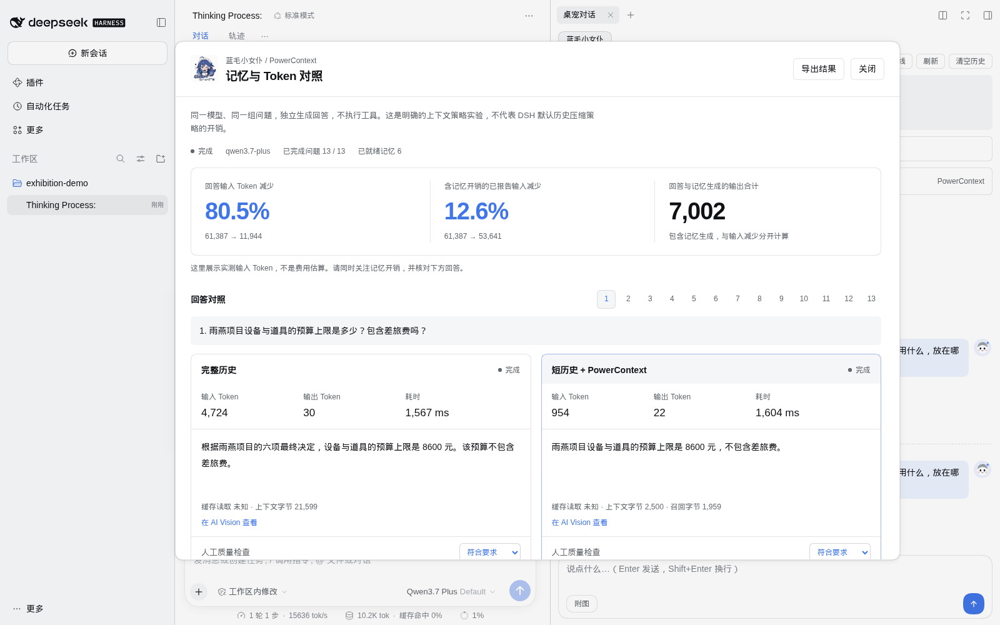
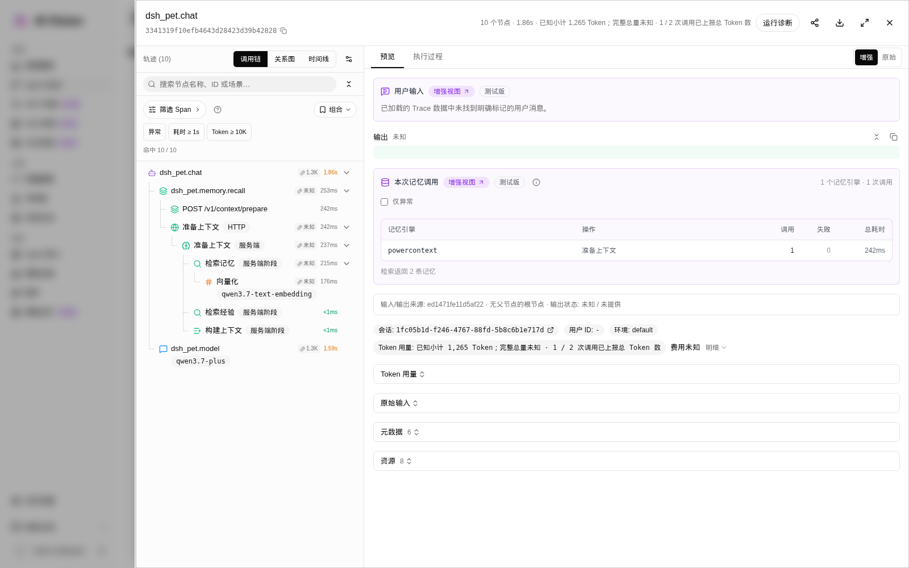

# README is coming soon

**A desktop companion that can chat, react to your work, and remember what matters to you.**

English · [简体中文](README.zh.md) · [Documentation](docs/en/README.md) · [Installation](docs/en/guides/installation.md) · [Releases](https://github.com/ob-labs/dsh-pet-powercontext/releases)

Drag the pet beside your work, give it a personality, and talk to it. Run it inside **DeepSeek Harness (DSH)** or as a **standalone app**. Optional **PowerContext + seekdb** memory keeps facts and preferences available after they leave the recent conversation window.

Built on [PC2005-cloud/dsh-pet](https://github.com/PC2005-cloud/dsh-pet).

This fork connects DeepSeek Harness Desktop to a XiaoZhi robot for shared chat, speech, and mapped movements. [小智桌面机器人完整教程](#小智桌面机器人完整教程)

Optional: [Astra Pro 2.0 MCP integration](docs/en/guides/robot.md) supports catalog discovery, teach programs, area movement and speech without client-side Python/SDK.

Optional: [AI Vision observability](docs/en/guides/observability.md) adds optional traces, input/output previews and links to the platform’s existing memory views. [Token comparison](docs/en/guides/token-comparison.md) compares answers and measured usage across three context strategies. These features are included in the v0.3.0 release package.

## 小智桌面机器人完整教程

在 DeepSeek Harness 桌面版给大肥鱼发消息，可以让真机念出回复，也可以让它做已映射的动作。直接对真机讲话时，语音转写和回复也进入同一份桌宠对话。以下步骤以 Apple Silicon Mac、Otto DIY ESP32-S3 固件 v2.5.3 和小智 Go v0.6.5 为例。

### 安装 fork 的桌面插件

准备 DeepSeek Harness 桌面版、Node.js 24 和 pnpm。若已启用上游 `dsh-pet` 插件，先停用它。保留 `$DSH_HOME/dsh-pet/` 可保留现有配置和记忆，`DSH_HOME` 默认是 `~/.dsh`。

完全退出桌面版，在终端安装这个 fork 的构建包。下面的 `add` 命令也可用于更新同名插件。

```sh
git clone --branch xiaozhi-robot https://github.com/beatenevo/dsh-pet-powercontext-xiaozhi.git
cd dsh-pet-powercontext-xiaozhi/dsh-pet
pnpm install --frozen-lockfile --ignore-scripts
mkdir -p "$PWD/../../xiaozhi-plugin-build"
npm pack --pack-destination "$PWD/../../xiaozhi-plugin-build"
dsh plugin --profile desktop add "$PWD/../../xiaozhi-plugin-build/dsh-pet-powercontext-0.3.2.tgz"
```

如果终端找不到 `dsh`，macOS 桌面版可使用 `/Applications/DeepSeek Harness.app/Contents/Resources/runtime/cli/bin/dsh`。重启 Harness 后打开「设置 → 桌宠配置」，在右侧栏的「桌宠对话」发一条消息确认能回复。桌宠未单独指定聊天模型时，沿用 Harness 当前选中的模型和对应的登录凭据或 API Key。

### 启动小智 Go 并绑定真机

1. 下载并解压与主机架构匹配的小智 Go v0.6.5 发布包，保留同目录的配置、模型和动态库。在解压目录启动服务。首次使用时打开 `http://127.0.0.1:8080/setup` 创建管理员，之后在 `http://127.0.0.1:8080/login` 登录。发布包的 README 包含开机启动说明。 [小智 Go v0.6.5 发布包](https://github.com/hackers365/xiaozhi-esp32-server-golang/releases/tag/v0.6.5)

   ```sh
   ./xiaozhi_server -c main_config.yaml -manager-enable=true -manager-config manager.json
   ```

2. 在本机后台创建智能体，例如「桌宠联动」。首次部署可用「配置向导 → OTA 配置」里的 MQTT/UDP 选项一起保存三个服务的配置。也可以在「服务配置 → OTA 配置」手动填写。以 `192.168.1.20` 为 Mac 的局域网 IP 示例，WebSocket 地址填 `ws://192.168.1.20:8989/xiaozhi/v1/`。使用 MQTT/UDP 常驻连接时，启用本机 MQTT 服务，在 OTA 中下发端点 `192.168.1.20:2883`，让 OTA 和 MQTT 服务使用同一签名密钥，并在 UDP 配置中将对外主机设为 `192.168.1.20`、端口设为 `8990`。若后台区分测试和生产配置，给设备实际使用的一项填写地址。
3. 让 Mac 和小智连到同一可互访的 Wi-Fi。在设备配网页填入 OTA 地址 `http://192.168.1.20:8989/xiaozhi/ota/`，保存后重启。设备显示六位绑定码后，到「智能体管理 → 设备列表 → 绑定设备」录入代码，并关联「桌宠联动」。已绑定的设备可在设备列表核对在线状态和归属。 [设备配网与绑定](https://docs.xiaozhi.me/zh/getting-started/wifi-and-binding.html)
4. 确认固件提供所需的 MCP 动作和主动播报。本文的动作与播报实测使用 Otto DIY ESP32-S3 v2.5.3。其他板型按各自固件的工具列表配置。若小智日志出现 `Unknown message type: notify`，请查板型对应的固件说明，确认支持 `notify` 再测试桌宠主动播报。 [Otto 固件下载与烧录说明](https://ottodiy.tech/docs/downloads)

配网页的 OTA 地址用于设备获取连接信息。后台仪表板显示「暂无 OTA 配置」时，到「服务配置 → OTA 配置」查看是否已保存。换 Wi-Fi 或热点以后，先确保设备和 Mac 能互访，再核对 Mac 的局域网 IP。IP 变动时更新 OTA、WebSocket、MQTT 和 UDP 的相关地址。先保留 Go 数据目录和原有绑定，设备连不上新地址时再进入配网页更新。日常联动通过 Wi-Fi，需要小智 Go 与 Harness 桌面版同时运行。设备可以独立供电，USB 数据线用于刷机或读取串口日志。

### 在桌宠里连接设备并测试播报

1. 在本机 Go 后台创建 OpenAPI Token，可直接打开 `http://127.0.0.1:8080/user/api-tokens`。在设备列表记下绑定设备的数字 `ID`。
2. 在 Harness 的「设置 → 桌宠配置 → 机器人设置」选择「小智机器人」，填入 **小智设备 OpenAPI 地址** `http://127.0.0.1:8080/api/open/v1` 和数字设备 ID，开启「启用机器人连接」并保存。填入上一步创建的 Token，点击「保存设备令牌」，再点击「检查连接」。设备当前发布的工具会显示在工具列表里。
3. 在 Go 后台「AI 配置 → TTS 配置」创建并测试一个启用的 TTS 配置，例如 Edge TTS 的 `zh-CN-XiaoxiaoNeural`，设为默认。再到桌宠对话的「小智机器人 → 手动控制」输入一句测试文本并点「让机器人播报」，从真机扬声器确认有声。打开「机器人播报桌宠发言」后，新的回复、碎碎念和梦话会交给小智播报。

`xiaozhi.me` 的 `wss://api.xiaozhi.me/mcp/` 接入点用于让官方云上的小智调用外部工具。这里的桌宠通过本机 Go 的 OpenAPI 调用设备和发起播报，令牌由本机 Go 管理。 [小智 MCP 接入说明](https://docs.xiaozhi.me/zh/mcp/quickstart.html)

### 映射跳舞和举放双手

在机器人设置的「高级设置」中添加动作，选择检查连接时发现的工具，再填动作名称和固定 JSON 参数。下面是实测设备的 `self_otto_action` 映射。其他固件请以工具列表中的名称和参数类型为准。

| 动作名   | 固定参数 JSON                                         |
| -------- | ----------------------------------------------------- |
| 跳舞     | `{"action":"radio_calisthenics"}`                     |
| 举起双手 | `{"action":"hands_up","direction":0,"speed":700}`     |
| 放下双手 | `{"action":"hands_down","direction":0,"speed":1000}`  |
| 举起左手 | `{"action":"hands_up","direction":1,"speed":1000}`    |
| 举起右手 | `{"action":"hands_up","direction":-1,"speed":1000}`   |
| 放下左手 | `{"action":"hands_down","direction":1,"speed":1000}`  |
| 放下右手 | `{"action":"hands_down","direction":-1,"speed":1000}` |

保存后开启「允许对话触发机器人动作」。默认需要点击当轮的确认按钮。想让明确指令直接执行时，再开启「直接执行模式（无需逐次确认）」。在桌宠对话输入「举起双手」即可先验证一次。完成下面的语音桥配置后，也可以直接对小智说「给我跳支舞吧」「举起左手」或「放下右手」。真机语音每轮匹配一个动作。遇到「抬手」这类没指定哪只手的说法，可以改说一个完整的映射名称，等这次做完再说下一条。

### 让真机麦克风接入同一份桌宠对话

1. 在桌宠配置中选好「语音识别」服务。先用桌宠聊天框的录音按钮测一段语音，确认能转成文字。识别服务沿用该配置，所需凭据取决于你选择的识别服务。
2. 在 Harness 主机创建本地桥配置。以下命令适用于首次配置，会生成独立的 64 字符十六进制令牌，并将权限设为仅当前用户可读写。已有 `xiaozhi-voice.json` 时直接使用原来的端口和令牌。保存后完全退出并重启 Harness。

   ```sh
   voice_dir="${DSH_HOME:-$HOME/.dsh}/dsh-pet"
   mkdir -p "$voice_dir"
   (
     umask 077
     set -C
     printf '{"port":9096,"token":"%s"}\n' "$(openssl rand -hex 32)" > "$voice_dir/xiaozhi-voice.json"
   )
   ```

3. 在同一台 Mac 的 Go 后台设置以下配置并启用。对只绑定一个智能体的安装，可以设为默认并让「桌宠联动」继承。语音桥只监听回环地址 `127.0.0.1`，机器人仍通过局域网连 Go。

   | 后台页面   | 配置值                                                                                                                              |
   | ---------- | ----------------------------------------------------------------------------------------------------------------------------------- |
   | VAD 配置   | 使用 `ten_vad`                                                                                                                      |
   | ASR 配置   | FunASR，主机 `127.0.0.1`，端口 `9096`，模式 `offline`，采样率 `16000`，块大小 `[5, 10, 5]`，块间隔 `10`，关闭自动结束，超时 `75` 秒 |
   | LLM 配置   | OpenAI，基础 URL `http://127.0.0.1:9096/v1`，模型 `dsh-pet`，API 密钥填桥配置文件中的 `token`                                       |
   | 智能体编辑 | 「桌宠联动」使用上述 LLM 和已测试的 TTS，关闭实时对话模式，使用普通转写对话                                                         |

4. 唤醒小智并对它说一句话，再看 Harness 桌宠对话里是否出现转写和回复。小智 Go 负责播报这轮回复。LLM 配置里的 OpenAI 选项用于连接本地桥，真正生成回复的是 Harness 里选中的聊天模型。桥令牌、设备 OpenAPI Token 和模型服务凭据分别填在各自的配置中。

### 开启声纹并验证昵称播报

1. 完整联动使用本仓库的小智 Go v0.6.5 补丁。补丁会把同一轮的声纹识别结果交给对话，并在 macOS 上为 Edge 普通话合成未返回音频的情况提供系统音色备用。构建步骤见下方。 [小智 Go 补丁](patches/xiaozhi-go/v0.6.5-speaker-audio.patch)
2. 在小智 Go 的 `asr_server.json` 将 `server.host` 设为 `127.0.0.1`，端口设为 `9000`，设置 `speaker.enabled=true` 和 `recognition.enabled=false`，保留安装包自带的声纹模型路径和存储设置。将 `manager.json` 的 `speaker_service.url` 设为 `http://127.0.0.1:9000`，并在后台「服务配置 → 声纹识别配置」填同一地址并启用。启动时追加下面的两个 ASR 参数。如果已构建补丁版，将命令开头的 `./xiaozhi_server` 换成 `./xiaozhi_server-patched`。在本机访问 `http://127.0.0.1:9000/health` 检查服务状态。

   ```sh
   ./xiaozhi_server -c main_config.yaml -manager-enable=true -manager-config manager.json \
     -asr-enable=true -asr-config asr_server.json
   ```

3. 在浏览器登录本机后台后直接打开 `http://127.0.0.1:8080/user/speakers`。创建声纹组，关联「桌宠联动」。可以对真机说一段 5–10 秒的清晰语音，再点「管理声纹 → 上传新样本 → 从历史记录选择」，试听并选自己的录音。也可以录制或上传 WAV。历史录音来源需要 Go 的历史记录功能保存用户音频。
4. 「描述」可以填备注，例如「本人声纹」。「Prompt」可以写「当前说话人是小明，昵称是『小明』。对方询问身份时，用这个昵称称呼他。你是大肥鱼，用第一人称回答。」想统一音色时，声纹组的 TTS 配置和音色可以留空，随智能体设置。若已给声纹组指定音色，识别命中后会优先用这个音色。
5. 用另一段录音点击「验证」，再对真机说「听得出我是谁吗？用我的昵称打个招呼」。检查桌宠文字是否包含昵称，并听真机读完。Go 的后台验证阈值与对话实时阈值分别配置，实测环境分别采用 `0.6` 和 `0.4`。保留「声纹聊天限制 → 关闭」时，未命中声纹的语音也能正常对话。

<details>
<summary>构建并安装带声纹和播报补丁的小智 Go</summary>

在终端进入本 fork 的根目录。准备 Go 1.24.11 和 Node.js。参照 v0.6.5 发布流程准备 libopus、`pkg-config`、ONNX Runtime 头文件和匹配的 sherpa-onnx 动态库，并在当前终端设置 `PKG_CONFIG_PATH`、`C_INCLUDE_PATH` 和 `CGO_LDFLAGS`，分别指向 opus 的 pkg-config 目录、ONNX Runtime 头文件目录和 sherpa-onnx 库目录（`-L` 参数）。然后应用补丁并构建。 [Go v0.6.5 macOS 构建环境](https://github.com/hackers365/xiaozhi-esp32-server-golang/blob/v0.6.5/.github/workflows/build-release.yml)

```sh
fork_root="$PWD"
git clone --recurse-submodules --branch v0.6.5 \
  https://github.com/hackers365/xiaozhi-esp32-server-golang.git ../xiaozhi-go-v0.6.5-src
cd ../xiaozhi-go-v0.6.5-src
git apply --check "$fork_root/patches/xiaozhi-go/v0.6.5-speaker-audio.patch"
git apply "$fork_root/patches/xiaozhi-go/v0.6.5-speaker-audio.patch"
(cd manager/frontend && npm ci && npm run build)
mkdir -p manager/backend/static/dist
cp -R manager/frontend/dist/. manager/backend/static/dist/
CGO_ENABLED=1 go build -tags 'nolibopusfile asr_server manager embed_ui' \
  -ldflags '-s -w -extldflags=-Wl,-headerpad_max_install_names' \
  -o xiaozhi_server-patched ./cmd/server
/bin/bash build/macos/fix_rpath.sh ./xiaozhi_server-patched
codesign --force --sign - ./xiaozhi_server-patched
```

将新二进制放进原发布包目录，与原来的 `xiaozhi_server` 并列。退出正在运行的 Go，改用新二进制启动，继续使用原发布包的配置、动态库和 `data/` 目录。若使用 `launchd`，同步更新启动程序路径。启动后先确认后台和声纹服务可访问，再让真机重新建立对话。

</details>

### 常见问题与实测记录

- **检查连接失败**。先确认 Go 正在运行、设备已绑定且在线，再核对 OpenAPI 地址、数字设备 ID 和在该地址保存的令牌。
- **桌宠有回复，真机没声音**。优先检查 Go 的 TTS 测试和设备音量，再核对固件是否支持主动播报 `notify`，以及设备能否访问 Go 发出的局域网音频地址。如果地址推导错误，可在 `main_config.yaml` 将 `notify.public_url` 设为设备可达的地址，例如 `http://192.168.1.20:8989`。用本仓库补丁时，Edge 合成故障会尝试由 macOS 普通话音色接管，该轮听起来会有音色变化。
- **小智麦克风能打开，桌宠没有转写**。先用桌宠录音按钮测试识别服务，再核对 `xiaozhi-voice.json`、FunASR 的端口与离线模式。若有转写但没有正常回复，核对 Go LLM 的回环地址和桥令牌。
- **识别到了声纹，回复里没有昵称**。检查声纹组是否关联当前智能体、是否填写 Prompt，以及 Go 是否运行带本仓库补丁的版本。后台没显示「声纹管理」时，登录后可直接打开 `/user/speakers`。
- **两种音色或想换音色**。智能体默认 TTS、声纹组覆盖项和 macOS 备用音色都可能影响听感。继续使用 Edge 小晓时，可清空声纹组的 TTS 覆盖以继承智能体。若选择「湾湾小何」，本机 Go 的豆包 WebSocket 配置需要开通该音色的火山引擎应用和访问令牌，测试通过后再切换。 [火山引擎音色列表](https://www.volcengine.com/docs/6561/1257544)
- **动作超时或断线**。先观察真机和动作回执，确认设备状态后再下达下一条指令。取消等待只能结束本机等待，设备需能提供停止工具才能由插件请求停止。

在上述 macOS 和 Otto 组合上，已实测桌宠回复由小智播报、真机语音进入同一份桌宠对话、声纹命中后念出昵称，以及真机直接执行跳舞、举起双手和放下双手。左右手分别举放已通过自动化测试。

## See it in use

### DSH, the pet and its memories


_The DSH agent session and pet panel share one workspace. PowerContext has generated two memories from pet dialogue: an equipment budget and the location of an offline fallback. The expanded memory list shows the facts and their source controls; delivery status alone is not proof of extraction or recall._

### Compare answers and token usage



_One synthetic scenario, real model calls: 13 questions reuse six generated memories. Compared with complete-background replay, answer input fell **80.5%** (61,387 → 11,944 tokens); including memory generation and embedding input, the reduction was **12.6%** (61,387 → 53,641). These are measured input counts, not a billing saving or a measurement of DSH's default task-agent policy._

The [first six questions](docs/assets/screenshots/dsh-token-first-batch.zh.png) **increased** input including memory overhead by **65.4%**. Known output also increased, and embedding output was unreported. Inspect the [token breakdown](docs/assets/screenshots/dsh-token-details.zh.png) and [comparison guide](docs/en/guides/token-comparison.md) before interpreting the savings.

### Follow a pet reply in AI Vision



_This separate, ordinary pet-chat trace follows recall into PowerContext and then the answer model. It contains 10 spans and two retrieved memories. Prompts and replies were not captured in this historical screenshot; AI Vision reports a known token subtotal and keeps the complete total unknown where usage is missing. This trace is not the comparison experiment's aggregate._

These unedited **1600 × 1000** screenshots were captured on **2026-11-15** in Linux Chromium, using **DSH 0.2.2-rc.1**, pet preview **`2e080f1`**, PowerContext **`1.5.2.dev148+gfa80ab6b2`** and a local AI Vision deployment. Demo facts are fictional; generation and embeddings use real services. Both READMEs preserve the original Chinese UI. [Capture details and limits](docs/assets/README.md#live-comparison-and-traces--对照与调用链实拍).

<details>
<summary>Watch the recorded chat and memory-recall GIFs</summary>


_The running DSH workspace, agent conversation and Pet chat panel together. Send a message and watch the pet reply and animate. Both conversations use real model responses; the project name and preference are fictional demo inputs._


_After background extraction, the pet recalls “Moonleaf” and “jasmine tea without sugar.” Recent chat is set to **0 rounds** for this demonstration: the model request contains recalled memories and the new question, with no past chat turns. Open **Remembered facts** to inspect the extracted facts._

Recorded on **2026-11-11** in **DSH 0.2.2-rc.1**, with **PowerContext + seekdb**, on Linux Chromium. These earlier GIFs retain the actual UI, including mixed-language controls. [Full-size chat screenshot](docs/assets/screenshots/dsh-chat.en.png) · [Recall and memory list](docs/assets/screenshots/dsh-facts.en.png) · [Media sources](docs/assets/README.md).

</details>

## Start with one pet

**The current source version is v0.3.2.** Use the commands below after this version is published. See [GitHub Releases](https://github.com/ob-labs/dsh-pet-powercontext/releases) for published versions and assets.

### Already using DSH

With DSH and **Node.js 24.9+** installed, run:

```sh
dsh plugin --profile web add dsh-pet-powercontext@0.3.2
```

For DSH desktop, replace `--profile web` with `--profile desktop`. Restart DSH, open **Settings → Pet Config**, and use **Pet chat** in the sidebar. Disable the upstream `dsh-pet` plugin first if enabled; retain its data directory.

### Standalone on Windows, macOS or Linux

With **Node.js 22.12+**, run in PowerShell or a terminal:

```sh
npx --yes dsh-pet-powercontext@0.3.2 --setup
```

Select a chat model, enter its key and check the connection in the setup page. Keep the terminal running. The animated pet needs a desktop environment and may download Electron on first launch. Standalone mode does not require DSH.

Windows x64 uses native installation; enabling memory automatically prepares Python and seekdb. Local seekdb on Windows ARM64 is not supported. Real-service validation has completed on Linux; the full Windows x64 and macOS installation flows still require real-host validation. Check the actual [Release assets](https://github.com/ob-labs/dsh-pet-powercontext/releases) for desktop downloads.

In v0.3.2, online memory setup uses mainland China mirrors by default without manual configuration: uv and Python packages come from Tsinghua, and managed Python comes from npmmirror. PowerContext is pinned to **1.5.2**, with version checks for both SQLite and seekdb installation and runtime reuse. Compatible local Python and cached dependencies are reused; offline packages use their bundled runtime. First-time setup also initializes and migrates the database, so complete it before a live demonstration.

### Configure models and enable memory

1. **Configure chat first.** The DSH pet uses the host chat model: enter the MiniMax endpoint, model and subscription key below in DSH model settings. Standalone users enter them in the app's settings.
2. **Open local long-term memory.** In DSH, open **Settings → Pet Config → Local long-term memory**, select MiniMax China and Qwen Beijing, and enter each service's key. Chat and memory extraction settings are saved separately.
3. **Click Check and enable memory.** The app checks model connections, installs PowerContext 1.5.2 and seekdb, and starts the service. Setup reuses compatible local Python installations and cached dependencies, displays progress, and downloads missing components. Cloud model calls still require network access. Memory is optional.
4. **Verify recall.** Tell the pet a distinctive preference and wait for it to appear in **Remembered facts**. Clear recent chat, then ask about it again. A synced status alone does not mean extraction has completed.

| Setting                      | Value                                                                              |
| ---------------------------- | ---------------------------------------------------------------------------------- |
| Chat / extraction provider   | MiniMax China subscription                                                         |
| Generation endpoint          | `https://api.minimax.cn/v1`                                                        |
| Generation model             | `MiniMax-M3.1-Flash`                                                               |
| Generation key               | Your `sk-cp-` subscription key; pay-as-you-go keys do not share subscription quota |
| Embedding provider           | Bailian: Qwen Beijing                                                              |
| Embedding endpoint           | `https://dashscope.aliyuncs.com/compatible-mode/v1`                                |
| Embedding model              | `text-embedding-v4`                                                                |
| Embedding key                | Your Bailian API key                                                               |
| Dimensions / send dimensions | `1024` / enabled                                                                   |

New setups use one local seekdb store. Existing SQLite configurations remain in place without automatic conversion. An existing store's embedding model, endpoint and dimensions cannot be switched in place. Model checks, chat, extraction and recall can incur usage charges.

### Optional AI Vision and Token comparison

AI Vision is a separate observability platform. Enter an existing platform's endpoint and credentials in observability settings, save and check the connection, then pause and resume memory to apply the configuration to the managed service. The plugin does not deploy AI Vision. Content capture is on by default when observability is enabled and can be disabled in settings; when on, prompts, replies and related memory content are sent to the configured platform.

Open **Token comparison** in Pet chat and use the demo-fill button to insert three fictional facts and three questions about a bookshop event. Edit the sample as needed; replacing an existing draft requires confirmation. Model calls begin only when you start the comparison.

The experiment uses the same model for full history, short history with PowerContext, and short history alone. v0.3.0 raises the output budget to 8,192 tokens for all three arms to leave room for visible answers from reasoning models. Usage reflects actual provider reports; truncated or empty answers still fail. Include extraction and embedding overhead. The built-in small sample demonstrates the workflow and does not guarantee token savings.

[Installation](docs/en/guides/installation.md) · [Memory guide](docs/en/guides/memory.md) · [AI Vision](docs/en/guides/observability.md) · [Token comparison](docs/en/guides/token-comparison.md)

## What you can do

| With the pet                                           | With PowerContext                                     |
| ------------------------------------------------------ | ----------------------------------------------------- |
| Click, drag, throw and play 100+ animation assets      | Recall facts beyond recent chat and across restarts   |
| Chat with a per-pet personality and configurable voice | Keep separate memory scopes for different pets        |
| Use to-dos, reminders, sleep and optional whispers     | Inspect sources, correct facts and request forgetting |
| React to DSH session work states                       | Bound recent text and recalled text independently     |
| Add your own character and animation pack              | Pause memory while keeping local chat available       |

DSH session integration, speech recognition, provider balances and other host features depend on the runtime and available services. A remembered promise does not automatically create a reminder or execute an action.

Presets include MiniMax, DeepSeek, OpenAI, Qwen, SiliconFlow, Volcengine Ark, Zhipu, Kimi, Ollama and an optional LiteLLM gateway. Chat, extraction and embeddings can use different providers. [Features](docs/en/reference/features.md) · [Animation gallery](docs/en/reference/gallery.md)

## Why memory helps—and what it costs

A short recent window keeps requests bounded. PowerContext turns completed text exchanges into background-extracted memories, then retrieves relevant evidence for a later reply. You can ask about an old preference without sending the entire transcript every time.


The supplied “教你如何多快好省来养大肥鱼” report used synthetic conversations with real model calls. Its results answer different questions:

| Experiment                                                  | Observation                                                    | Read it with this boundary                                                                        |
| ----------------------------------------------------------- | -------------------------------------------------------------- | ------------------------------------------------------------------------------------------------- |
| 140-round replay: native 10 vs. 4 recent rounds             | **35.8% less chat input** with the smaller window              | It recovered 0/25 old target facts; adding memory recovered 25/25 and added overhead              |
| 1,000 initial rounds reused over 100 questions              | **88.9% less known generation input** with memory              | Compared with full-history replay, not native 10-round mode                                       |
| Same reuse experiment, including processing and maintenance | **CNY 4.73 vs. 6.99**, or **32.3% lower estimated known cost** | Historical prices; different answer outcomes and seven unpriced control calls; not an actual bill |

Memory is not automatically cheaper: short workloads and large initial imports can cost more. Read the [full experiment, original figures and limitations](docs/en/explanation/memory-and-cost.md), then [tune your own token budget](docs/en/guides/token-budget.md).

## Keep control of your data

Memory is optional and disabled by default. Managed setup starts with four recent rounds, 6,000 recent-text bytes and 4,096 recall-text bytes. Bytes are not tokens; extraction, output, retries and other features have their own costs.

- **Synced** means dialogue reached PowerContext; it does not mean extraction or recall has succeeded.
- **Pause** keeps data. **Forget** excludes an atomic memory from recall while retaining sources and old revisions. Deleting local chat does not erase remote evidence.
- Managed memory runs on the host under `$DSH_HOME/dsh-pet/powercontext/`. Remote model providers still receive the text required for generation and embeddings.
- Only pet dialogue is captured. This integration does not add memory to DSH coding-agent sessions or automatically import old chats.

[Enable, verify and manage memory](docs/en/guides/memory.md)

## Documentation and development

| Find your next step           | English                                                                                  | 简体中文                                                                      |
| ----------------------------- | ---------------------------------------------------------------------------------------- | ----------------------------------------------------------------------------- |
| Learn by using the pet        | [First pet](docs/en/tutorials/first-pet.md)                                              | [养好第一只桌宠](docs/zh/tutorials/first-pet.md)                              |
| Configure and troubleshoot    | [Guides](docs/en/README.md#do)                                                           | [操作指南](docs/zh/README.md#解决具体问题)                                    |
| Integrate another application | [HTTP](docs/en/reference/http-api.md) · [Cordis](docs/en/reference/cordis.md)            | [HTTP](docs/zh/reference/http-api.md) · [Cordis](docs/zh/reference/cordis.md) |
| Build or publish              | [Development](docs/en/reference/development.md) · [Releases](docs/en/guides/releases.md) | [开发](docs/zh/reference/development.md) · [发布](docs/zh/guides/releases.md) |

Source code is in the inner `dsh-pet/` package:

| Directory             | Responsibility                                               |
| --------------------- | ------------------------------------------------------------ |
| `src/host/`           | Configuration, HTTP routes, chat, queues and DSH integration |
| `src/client/`         | Pet rendering, settings and chat UI                          |
| `src/shared/`         | Shared types, animation and interaction rules                |
| `src/standalone/`     | Local app, model setup and managed memory lifecycle          |
| `runtime/`, `assets/` | Electron shell and character resources                       |

## Credits and licensing

Code is [MIT licensed](LICENSE). Character artwork, animation, prompts and source video have [separate terms and credits](dsh-pet/ASSET-LICENSE.md), including the upstream CC BY-NC-SA 4.0 attribution. They are not covered by the code license.

The community-created whale girl is not an official DeepSeek character. Original character “溟月”: [上善无形](https://space.bilibili.com/4456176); maid whale-girl design: [ZipZipPipe](https://space.bilibili.com/4168597); original desktop pet: [PC2005-cloud/dsh-pet](https://github.com/PC2005-cloud/dsh-pet). Long-term memory: [PowerContext](https://github.com/oceanbase/powercontext).
