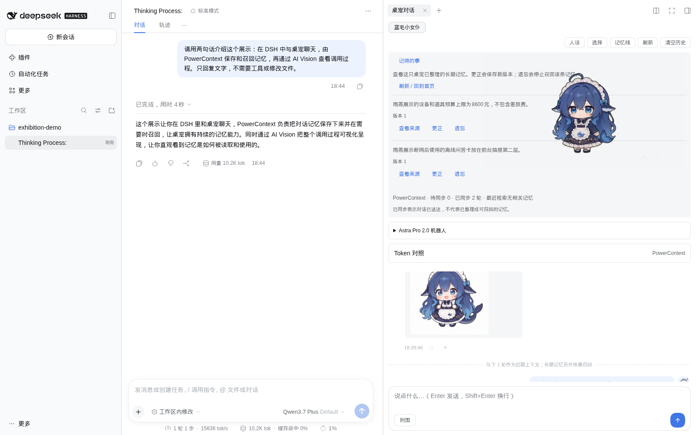

# dsh-pet-powercontext

**A desktop companion that can chat, react to your work, and remember what matters to you.**

English · [简体中文](README.zh.md) · [Documentation](docs/en/README.md) · [Installation](docs/en/guides/installation.md) · [Releases](https://github.com/ob-labs/dsh-pet-powercontext/releases)

Drag the pet beside your work, give it a personality, and talk to it. Run it inside **DeepSeek Harness (DSH)** or as a **standalone app**. Optional **PowerContext + seekdb** memory keeps facts and preferences available after they leave the recent conversation window.

Built on [PC2005-cloud/dsh-pet](https://github.com/PC2005-cloud/dsh-pet).

This fork builds on [ob-labs/dsh-pet-powercontext](https://github.com/ob-labs/dsh-pet-powercontext) and retains its existing features. The optional XiaoZhi adapter lets the on-screen pet and a physical robot share a conversation in DeepSeek Harness Desktop. [XiaoZhi setup guide](#connect-a-xiaozhi-desktop-robot)

Optional: [Astra Pro 2.0 MCP integration](docs/en/guides/robot.md) supports catalog discovery, teach programs, area movement and speech without client-side Python/SDK.

Optional: [AI Vision observability](docs/en/guides/observability.md) adds optional traces, input/output previews and links to the platform’s existing memory views. [Token comparison](docs/en/guides/token-comparison.md) compares answers and measured usage across three context strategies. These features are included in the v0.3.0 release package.

## See it in use

### DSH, the pet and its memories



_The DSH agent session and pet panel share one workspace. PowerContext has generated two memories from pet dialogue: an equipment budget and the location of an offline fallback. The expanded memory list shows the facts and their source controls; delivery status alone is not proof of extraction or recall._

### Compare answers and token usage


_One synthetic scenario, real model calls: 13 questions reuse six generated memories. Compared with complete-background replay, answer input fell **80.5%** (61,387 → 11,944 tokens); including memory generation and embedding input, the reduction was **12.6%** (61,387 → 53,641). These are measured input counts, not a billing saving or a measurement of DSH's default task-agent policy._

The [first six questions](docs/assets/screenshots/dsh-token-first-batch.zh.png) **increased** input including memory overhead by **65.4%**. Known output also increased, and embedding output was unreported. Inspect the [token breakdown](docs/assets/screenshots/dsh-token-details.zh.png) and [comparison guide](docs/en/guides/token-comparison.md) before interpreting the savings.

### Follow a pet reply in AI Vision


_This separate, ordinary pet-chat trace follows recall into PowerContext and then the answer model. It contains 10 spans and two retrieved memories. Prompts and replies were not captured in this historical screenshot; AI Vision reports a known token subtotal and keeps the complete total unknown where usage is missing. This trace is not the comparison experiment's aggregate._

These unedited **1600 × 1000** screenshots were captured on **2026-11-15** in Linux Chromium, using **DSH 0.2.2-rc.1**, pet preview **`2e080f1`**, PowerContext **`1.5.2.dev148+gfa80ab6b2`** and a local AI Vision deployment. Demo facts are fictional; generation and embeddings use real services. Both READMEs preserve the original Chinese UI. [Capture details and limits](docs/assets/README.md#live-comparison-and-traces--对照与调用链实拍).

<details>
<summary>Watch the recorded chat and memory-recall GIFs</summary>


_The running DSH workspace, agent conversation and Pet chat panel together. Send a message and watch the pet reply and animate. Both conversations use real model responses; the project name and preference are fictional demo inputs._


_After background extraction, the pet recalls “Moonleaf” and “jasmine tea without sugar.” Recent chat is set to **0 rounds** for this demonstration: the model request contains recalled memories and the new question, with no past chat turns. Open **Remembered facts** to inspect the extracted facts._

Recorded on **2026-11-11** in **DSH 0.2.2-rc.1**, with **PowerContext + seekdb**, on Linux Chromium. These earlier GIFs retain the actual UI, including mixed-language controls. [Full-size chat screenshot](docs/assets/screenshots/dsh-chat.en.png) · [Recall and memory list](docs/assets/screenshots/dsh-facts.en.png) · [Media sources](docs/assets/README.md).

</details>

## Start with one pet

**The current source version is v0.3.2.** Use the commands below after this version is published. See [GitHub Releases](https://github.com/ob-labs/dsh-pet-powercontext/releases) for published versions and assets.

### Already using DSH

With DSH and **Node.js 24.9+** installed, run:

```sh
dsh plugin --profile web add dsh-pet-powercontext@0.3.2
```

For DSH desktop, replace `--profile web` with `--profile desktop`. Restart DSH, open **Settings → Pet Config**, and use **Pet chat** in the sidebar. Disable the upstream `dsh-pet` plugin first if enabled; retain its data directory.

### Standalone on Windows, macOS or Linux

With **Node.js 22.12+**, run in PowerShell or a terminal:

```sh
npx --yes dsh-pet-powercontext@0.3.2 --setup
```

Select a chat model, enter its key and check the connection in the setup page. Keep the terminal running. The animated pet needs a desktop environment and may download Electron on first launch. Standalone mode does not require DSH.

Windows x64 uses native installation; enabling memory automatically prepares Python and seekdb. Local seekdb on Windows ARM64 is not supported. Real-service validation has completed on Linux; the full Windows x64 and macOS installation flows still require real-host validation. Check the actual [Release assets](https://github.com/ob-labs/dsh-pet-powercontext/releases) for desktop downloads.

In v0.3.2, online memory setup uses mainland China mirrors by default without manual configuration: uv and Python packages come from Tsinghua, and managed Python comes from npmmirror. PowerContext is pinned to **1.5.2**, with version checks for both SQLite and seekdb installation and runtime reuse. Compatible local Python and cached dependencies are reused; offline packages use their bundled runtime. First-time setup also initializes and migrates the database, so complete it before a live demonstration.

### Configure models and enable memory

1. **Configure chat first.** The DSH pet uses the host chat model: enter the MiniMax endpoint, model and subscription key below in DSH model settings. Standalone users enter them in the app's settings.
2. **Open local long-term memory.** In DSH, open **Settings → Pet Config → Local long-term memory**, select MiniMax China and Qwen Beijing, and enter each service's key. Chat and memory extraction settings are saved separately.
3. **Click Check and enable memory.** The app checks model connections, installs PowerContext 1.5.2 and seekdb, and starts the service. Setup reuses compatible local Python installations and cached dependencies, displays progress, and downloads missing components. Cloud model calls still require network access. Memory is optional.
4. **Verify recall.** Tell the pet a distinctive preference and wait for it to appear in **Remembered facts**. Clear recent chat, then ask about it again. A synced status alone does not mean extraction has completed.

| Setting                      | Value                                                                              |
| ---------------------------- | ---------------------------------------------------------------------------------- |
| Chat / extraction provider   | MiniMax China subscription                                                         |
| Generation endpoint          | `https://api.minimax.cn/v1`                                                        |
| Generation model             | `MiniMax-M3.1-Flash`                                                               |
| Generation key               | Your `sk-cp-` subscription key; pay-as-you-go keys do not share subscription quota |
| Embedding provider           | Bailian: Qwen Beijing                                                              |
| Embedding endpoint           | `https://dashscope.aliyuncs.com/compatible-mode/v1`                                |
| Embedding model              | `text-embedding-v4`                                                                |
| Embedding key                | Your Bailian API key                                                               |
| Dimensions / send dimensions | `1024` / enabled                                                                   |

New setups use one local seekdb store. Existing SQLite configurations remain in place without automatic conversion. An existing store's embedding model, endpoint and dimensions cannot be switched in place. Model checks, chat, extraction and recall can incur usage charges.

### Optional AI Vision and Token comparison

AI Vision is a separate observability platform. Enter an existing platform's endpoint and credentials in observability settings, save and check the connection, then pause and resume memory to apply the configuration to the managed service. The plugin does not deploy AI Vision. Content capture is on by default when observability is enabled and can be disabled in settings; when on, prompts, replies and related memory content are sent to the configured platform.

Open **Token comparison** in Pet chat and use the demo-fill button to insert three fictional facts and three questions about a bookshop event. Edit the sample as needed; replacing an existing draft requires confirmation. Model calls begin only when you start the comparison.

The experiment uses the same model for full history, short history with PowerContext, and short history alone. v0.3.0 raises the output budget to 8,192 tokens for all three arms to leave room for visible answers from reasoning models. Usage reflects actual provider reports; truncated or empty answers still fail. Include extraction and embedding overhead. The built-in small sample demonstrates the workflow and does not guarantee token savings.

[Installation](docs/en/guides/installation.md) · [Memory guide](docs/en/guides/memory.md) · [AI Vision](docs/en/guides/observability.md) · [Token comparison](docs/en/guides/token-comparison.md)

## What you can do

| With the pet                                           | With PowerContext                                     |
| ------------------------------------------------------ | ----------------------------------------------------- |
| Click, drag, throw and play 100+ animation assets      | Recall facts beyond recent chat and across restarts   |
| Chat with a per-pet personality and configurable voice | Keep separate memory scopes for different pets        |
| Use to-dos, reminders, sleep and optional whispers     | Inspect sources, correct facts and request forgetting |
| React to DSH session work states                       | Bound recent text and recalled text independently     |
| Add your own character and animation pack              | Pause memory while keeping local chat available       |

DSH session integration, speech recognition, provider balances and other host features depend on the runtime and available services. A remembered promise does not automatically create a reminder or execute an action.

Presets include MiniMax, DeepSeek, OpenAI, Qwen, SiliconFlow, Volcengine Ark, Zhipu, Kimi, Ollama and an optional LiteLLM gateway. Chat, extraction and embeddings can use different providers. [Features](docs/en/reference/features.md) · [Animation gallery](docs/en/reference/gallery.md)

## Why memory helps—and what it costs

A short recent window keeps requests bounded. PowerContext turns completed text exchanges into background-extracted memories, then retrieves relevant evidence for a later reply. You can ask about an old preference without sending the entire transcript every time.


The supplied “教你如何多快好省来养大肥鱼” report used synthetic conversations with real model calls. Its results answer different questions:

| Experiment                                                  | Observation                                                    | Read it with this boundary                                                                        |
| ----------------------------------------------------------- | -------------------------------------------------------------- | ------------------------------------------------------------------------------------------------- |
| 140-round replay: native 10 vs. 4 recent rounds             | **35.8% less chat input** with the smaller window              | It recovered 0/25 old target facts; adding memory recovered 25/25 and added overhead              |
| 1,000 initial rounds reused over 100 questions              | **88.9% less known generation input** with memory              | Compared with full-history replay, not native 10-round mode                                       |
| Same reuse experiment, including processing and maintenance | **CNY 4.73 vs. 6.99**, or **32.3% lower estimated known cost** | Historical prices; different answer outcomes and seven unpriced control calls; not an actual bill |

Memory is not automatically cheaper: short workloads and large initial imports can cost more. Read the [full experiment, original figures and limitations](docs/en/explanation/memory-and-cost.md), then [tune your own token budget](docs/en/guides/token-budget.md).

## Keep control of your data

Memory is optional and disabled by default. Managed setup starts with four recent rounds, 6,000 recent-text bytes and 4,096 recall-text bytes. Bytes are not tokens; extraction, output, retries and other features have their own costs.

- **Synced** means dialogue reached PowerContext; it does not mean extraction or recall has succeeded.
- **Pause** keeps data. **Forget** excludes an atomic memory from recall while retaining sources and old revisions. Deleting local chat does not erase remote evidence.
- Managed memory runs on the host under `$DSH_HOME/dsh-pet/powercontext/`. Remote model providers still receive the text required for generation and embeddings.
- Only pet dialogue is captured. This integration does not add memory to DSH coding-agent sessions or automatically import old chats.

[Enable, verify and manage memory](docs/en/guides/memory.md)

## Connect a XiaoZhi desktop robot

The pet and XiaoZhi are two ways to talk to the same companion. Type in Pet chat to hear the reply on the robot, or speak into the robot and see the transcript and reply in that same chat. You can also ask it to perform an action that you've mapped to a tool on the device. The setup below uses DeepSeek Harness Desktop on an Apple Silicon Mac, XiaoZhi Go v0.6.5, and an Otto DIY ESP32-S3 running its v2.5.3 firmware. XiaoZhi Go runs locally and handles the device connection and speech playback. Harness handles pet chat and uses its current model and sign-in or API key unless you configure a separate model for the pet.

### Install the fork in Harness Desktop

The standard installation steps above refer to the upstream package. For XiaoZhi support, build and install this fork with Node.js 24.9+ and pnpm. Disable any existing upstream pet plugin and quit Harness Desktop before installing. Keep the existing pet data directory at `$DSH_HOME/dsh-pet/` to retain settings and memory. The default DSH home is `~/.dsh`.

```sh
git clone https://github.com/beatenevo/dsh-pet-powercontext-xiaozhi.git
cd dsh-pet-powercontext-xiaozhi/dsh-pet
pnpm install --frozen-lockfile --ignore-scripts
mkdir -p ../xiaozhi-plugin-build
npm pack --pack-destination ../xiaozhi-plugin-build
dsh plugin --profile desktop add "$PWD/../xiaozhi-plugin-build/dsh-pet-powercontext-0.3.2.tgz"
```

If `dsh` is unavailable in the terminal, use `/Applications/DeepSeek Harness.app/Contents/Resources/runtime/cli/bin/dsh` on macOS. Reopen Harness, go to **Settings → Pet configuration**, and send a message in sidebar **Pet chat** to check the model connection.

### Start XiaoZhi Go and pair the device

1. Download the v0.6.5 archive for your host architecture and extract it with its configuration, models, and libraries. Start the server from the extracted directory. Create an admin at `http://127.0.0.1:8080/setup` on first launch, then sign in at `http://127.0.0.1:8080/login`. The release README covers startup at login. [XiaoZhi Go v0.6.5 release](https://github.com/hackers365/xiaozhi-esp32-server-golang/releases/tag/v0.6.5)

   ```sh
   ./xiaozhi_server -c main_config.yaml -manager-enable=true -manager-config manager.json
   ```

2. Create an agent in the Go console, for example **Desktop Pet**. Under **Service configuration → OTA configuration**, use your host's LAN address for WebSocket, for example `ws://192.168.1.20:8989/xiaozhi/v1/`. To keep the device connected while idle over MQTT/UDP, use the setup wizard's MQTT/UDP option or enable MQTT and publish `192.168.1.20:2883` in OTA. Use the same signing key in the OTA and MQTT settings and set the UDP public host to `192.168.1.20` and port to `8990`. If the console separates test and production settings, configure the profile the device uses.
3. Connect the host and robot to Wi-Fi on the same reachable network. Replace the example IP with your host's LAN IP in the device provisioning page's OTA URL, `http://192.168.1.20:8989/xiaozhi/ota/`. Save and reboot. Enter the six-digit code in **Agent management → Devices → Bind device**, assign the agent, and check that the device is online. [Wi-Fi provisioning and pairing](https://docs.xiaozhi.me/en/getting-started/wifi-and-binding.html)
4. Use firmware that exposes the MCP tools for your device and supports push speech (`notify`). The examples below use Otto DIY ESP32-S3 v2.5.3. Use the tool catalog exposed by your own firmware to configure other boards. [Otto firmware and flashing instructions](https://ottodiy.tech/docs/downloads)

Keep Harness Desktop and XiaoZhi Go running for everyday use. The robot can use its own power supply and communicate over Wi-Fi. When changing networks, keep the Go data directory and pairing, check reachability, and update LAN addresses in OTA, WebSocket, MQTT, and UDP if the host IP changes. Update the device's provisioning URL if it can no longer reach OTA.

### Connect Pet chat and test speech

1. Open `http://127.0.0.1:8080/user/api-tokens` and create a device OpenAPI token. Copy the numeric device record ID from the Go device list.
2. In **Settings → Pet configuration → Robot settings**, select **XiaoZhi robot**. Set **XiaoZhi device OpenAPI URL** to `http://127.0.0.1:8080/api/open/v1`, enter the device ID, enable the connection, and save. Choose **Save device token**, then **Check connection** to discover the device tools.
3. In the Go console under **AI configuration → TTS configuration**, enable, test, and set a default TTS configuration. Edge TTS with `zh-CN-XiaoxiaoNeural` is one option. In **Pet chat → XiaoZhi robot → Manual controls**, enter a sentence and choose **Speak through robot**. After hearing it on the robot, enable **Speak all pet messages through the robot** to play new replies, whispers, and sleep talk.

Pet chat uses the local Go OpenAPI to invoke device tools and push speech. The `xiaozhi.me` WebSocket MCP endpoint lets the official cloud agent call external tools. [XiaoZhi MCP quickstart](https://docs.xiaozhi.me/en/mcp/quickstart.html)

### Map a dance and arm movements

In **Robot settings → Advanced**, add a name for each action, choose a discovered tool, and enter its fixed JSON arguments. These examples use the Otto device tool `self_otto_action`. Use the tool names and argument types reported by your own device.

| Action name           | Fixed JSON arguments                                  |
| --------------------- | ----------------------------------------------------- |
| Dance                 | `{"action":"radio_calisthenics"}`                     |
| Raise both hands      | `{"action":"hands_up","direction":0,"speed":700}`     |
| Lower both hands      | `{"action":"hands_down","direction":0,"speed":1000}`  |
| Raise your left hand  | `{"action":"hands_up","direction":1,"speed":1000}`    |
| Raise your right hand | `{"action":"hands_up","direction":-1,"speed":1000}`   |
| Lower your left hand  | `{"action":"hands_down","direction":1,"speed":1000}`  |
| Lower your right hand | `{"action":"hands_down","direction":-1,"speed":1000}` |

Save and enable **Allow robot actions from chat**. Actions require confirmation by default. With **Direct execution mode** enabled, explicit requests dispatch the saved mappings in order. First try a mapped phrase in Pet chat. After setting up the voice bridge, you can also say it to XiaoZhi. A robot voice turn matches one action at a time. Use the full action name for an ambiguous request such as “raise a hand.”

### Add the robot microphone to Pet chat

1. Set up **Speech recognition** in Pet configuration and check transcription with the Pet chat recording button. The voice bridge uses the same recognition service and its configured credentials.
2. Run the following on the Harness host for a first-time setup. It creates a private `xiaozhi-voice.json` with a random bridge token. If the file already exists, keep its port and token. Quit and restart Harness Desktop after creating it.

   ```sh
   voice_dir="${DSH_HOME:-$HOME/.dsh}/dsh-pet"
   mkdir -p "$voice_dir"
   (
     umask 077
     set -C
     printf '{"port":9096,"token":"%s"}\n' "$(openssl rand -hex 32)" > "$voice_dir/xiaozhi-voice.json"
   )
   ```

3. Configure the following in XiaoZhi Go on the same host. For a single-agent installation, you can set these as defaults and let your agent inherit them. The bridge listens on loopback and the robot continues to reach Go over the LAN.

   | Console page      | Settings                                                                                                                                                                |
   | ----------------- | ----------------------------------------------------------------------------------------------------------------------------------------------------------------------- |
   | VAD configuration | Use `ten_vad`.                                                                                                                                                          |
   | ASR configuration | FunASR, host `127.0.0.1`, port `9096`, mode `offline`, sample rate `16000`, chunk size `[5, 10, 5]`, chunk interval `10`, automatic end disabled, timeout `75` seconds. |
   | LLM configuration | OpenAI, base URL `http://127.0.0.1:9096/v1`, model `dsh-pet`, API key set to the bridge file's `token`.                                                                 |
   | Agent settings    | Select the bridge LLM and your tested TTS, disable real-time conversation mode, and use the standard transcription dialogue.                                            |

4. Wake XiaoZhi and say a sentence. Check that the transcript and response appear in Pet chat and listen for the response through the robot. Go's OpenAI-compatible LLM entry forwards this turn to Harness. The bridge token, device OpenAPI token, and model credentials belong to their respective settings.

### Set up voiceprint recognition and nickname greetings

1. Install the fork's Go v0.6.5 patch using the build steps below. It passes voiceprint recognition to the corresponding dialogue turn and adds a macOS Mandarin fallback for Edge Mandarin synthesis that returns no audio. [Go patch](patches/xiaozhi-go/v0.6.5-speaker-audio.patch)
2. In Go's `asr_server.json`, set `server.host` to `127.0.0.1` and the port to `9000`, enable `speaker.enabled`, and set `recognition.enabled=false`. Keep the packaged voiceprint model paths and storage settings. Set `speaker_service.url` in `manager.json` to `http://127.0.0.1:9000`, then enable **Service configuration → Voiceprint recognition** with the same URL. Restart with the following command and check `http://127.0.0.1:9000/health`.

   ```sh
   ./xiaozhi_server-patched -c main_config.yaml -manager-enable=true -manager-config manager.json \
     -asr-enable=true -asr-config asr_server.json
   ```

3. Sign in and visit `http://127.0.0.1:8080/user/speakers`. Create a voiceprint group and assign it to your agent. Record or upload a clean 5–10 second WAV sample. If Go is configured to save user audio, you can also select a sample from conversation history.
4. Add a description for your own reference. For the group's Prompt, try “The speaker's nickname is Ming. Use that nickname when asked to identify the speaker. Reply in the first person as the pet.” Leave the group's TTS configuration and voice blank to inherit the agent's voice.
5. Verify against a different sample, then ask the robot to greet you by nickname. Check the text in Pet chat and listen for the same nickname on the robot. Console verification and live conversations have separate thresholds. The tested setup used `0.6` and `0.4` respectively. Leave voiceprint chat restrictions off to allow conversations when no match is found.

<details>
<summary>Build XiaoZhi Go with the voiceprint and speech patch</summary>

Run from the root of this fork. Prepare Go 1.24.11, Node.js, libopus, `pkg-config`, ONNX Runtime headers, and matching sherpa-onnx libraries. Set `PKG_CONFIG_PATH` for opus, `C_INCLUDE_PATH` for the ONNX Runtime headers, and `CGO_LDFLAGS` with a `-L` path to the sherpa-onnx libraries. [macOS build workflow](https://github.com/hackers365/xiaozhi-esp32-server-golang/blob/v0.6.5/.github/workflows/build-release.yml)

```sh
fork_root="$PWD"
git clone --recurse-submodules --branch v0.6.5 \
  https://github.com/hackers365/xiaozhi-esp32-server-golang.git ../xiaozhi-go-v0.6.5-src
cd ../xiaozhi-go-v0.6.5-src
git apply --check "$fork_root/patches/xiaozhi-go/v0.6.5-speaker-audio.patch"
git apply "$fork_root/patches/xiaozhi-go/v0.6.5-speaker-audio.patch"
(cd manager/frontend && npm ci && npm run build)
mkdir -p manager/backend/static/dist
cp -R manager/frontend/dist/. manager/backend/static/dist/
CGO_ENABLED=1 go build -tags 'nolibopusfile asr_server manager embed_ui' \
  -ldflags '-s -w -extldflags=-Wl,-headerpad_max_install_names' \
  -o xiaozhi_server-patched ./cmd/server
/bin/bash build/macos/fix_rpath.sh ./xiaozhi_server-patched
codesign --force --sign - ./xiaozhi_server-patched
```

Put `xiaozhi_server-patched` next to the original binary in the release directory. Stop Go and start the patched binary with the existing configuration, libraries, and `data/` directory. If you use `launchd`, update its program path. Check the console and voiceprint service before reconnecting the robot.

</details>

### Troubleshooting

- **No OTA configuration on the dashboard.** Open **Service configuration → OTA configuration** and check that you saved the profile the device uses.
- **Connection check fails.** Check that Go is running and the paired robot is online. Verify the OpenAPI URL, numeric device ID, and token saved for that URL.
- **Pet chat replies but the robot is silent.** Test Go's TTS and check the robot's volume, `notify` firmware support, and whether the device can reach the LAN audio URL. The device log message `Unknown message type: notify` indicates missing firmware support. If Go advertises the wrong address, set `notify.public_url` in `main_config.yaml` to a device-reachable address such as `http://192.168.1.20:8989`.
- **The robot switches voices.** In Go, check the agent's TTS and the speaker group's TTS configuration and voice. A matched group's TTS can override the agent's settings. Clear the group overrides to inherit the agent's voice. The macOS patch can also use the system's Tingting voice for a turn when Edge Mandarin synthesis returns no audio. To use 湾湾小何, the Go Doubao WebSocket TTS configuration needs a Volcengine application and token with access to that voice. [Volcengine voice catalog](https://www.volcengine.com/docs/6561/1257544)
- **The microphone opens but nothing is transcribed.** Test the Pet chat recorder first, then verify the bridge file and the FunASR port and mode. If text appears without a reply, check Go's loopback LLM URL and bridge token.
- **Recognition succeeds but the nickname is missing.** Check that your speaker group is linked to the current agent, that its Prompt contains the nickname, and that Go is running the patched binary.
- **An action times out or the device disconnects.** Check the robot and action receipt before sending another command. Cancel affects the local wait. Stopping the robot from the plugin requires a stop tool on the device.

The macOS and Otto setup above was tested with pet speech on the robot, voice input through the robot in the shared chat, a voiceprint greeting with the correct nickname, and direct voice commands to dance, raise both hands, and lower both hands. Single-hand raise and lower mappings were covered by automated tests.

## Documentation and development

| Find your next step           | English                                                                                  | 简体中文                                                                      |
| ----------------------------- | ---------------------------------------------------------------------------------------- | ----------------------------------------------------------------------------- |
| Learn by using the pet        | [First pet](docs/en/tutorials/first-pet.md)                                              | [养好第一只桌宠](docs/zh/tutorials/first-pet.md)                              |
| Configure and troubleshoot    | [Guides](docs/en/README.md#do)                                                           | [操作指南](docs/zh/README.md#解决具体问题)                                    |
| Integrate another application | [HTTP](docs/en/reference/http-api.md) · [Cordis](docs/en/reference/cordis.md)            | [HTTP](docs/zh/reference/http-api.md) · [Cordis](docs/zh/reference/cordis.md) |
| Build or publish              | [Development](docs/en/reference/development.md) · [Releases](docs/en/guides/releases.md) | [开发](docs/zh/reference/development.md) · [发布](docs/zh/guides/releases.md) |

Source code is in the inner `dsh-pet/` package:

| Directory             | Responsibility                                               |
| --------------------- | ------------------------------------------------------------ |
| `src/host/`           | Configuration, HTTP routes, chat, queues and DSH integration |
| `src/client/`         | Pet rendering, settings and chat UI                          |
| `src/shared/`         | Shared types, animation and interaction rules                |
| `src/standalone/`     | Local app, model setup and managed memory lifecycle          |
| `runtime/`, `assets/` | Electron shell and character resources                       |

## Credits and licensing

Code is [MIT licensed](LICENSE). Character artwork, animation, prompts and source video have [separate terms and credits](dsh-pet/ASSET-LICENSE.md), including the upstream CC BY-NC-SA 4.0 attribution. They are not covered by the code license.

The community-created whale girl is not an official DeepSeek character. Original character “溟月”: [上善无形](https://space.bilibili.com/4456176); maid whale-girl design: [ZipZipPipe](https://space.bilibili.com/4168597); original desktop pet: [PC2005-cloud/dsh-pet](https://github.com/PC2005-cloud/dsh-pet). Long-term memory: [PowerContext](https://github.com/oceanbase/powercontext).
