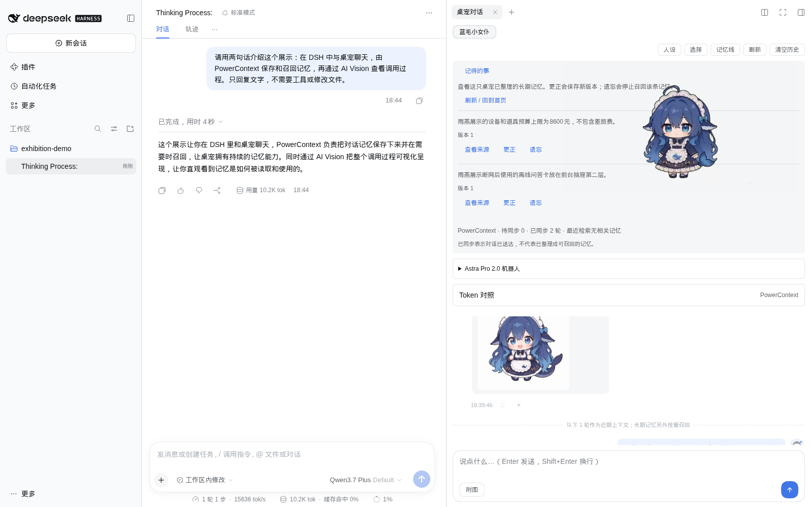
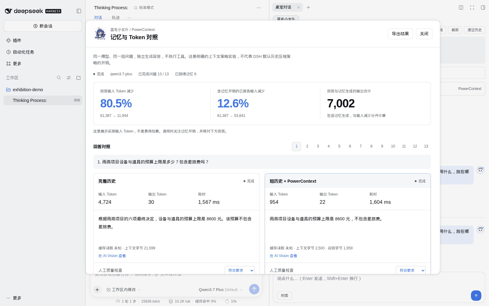
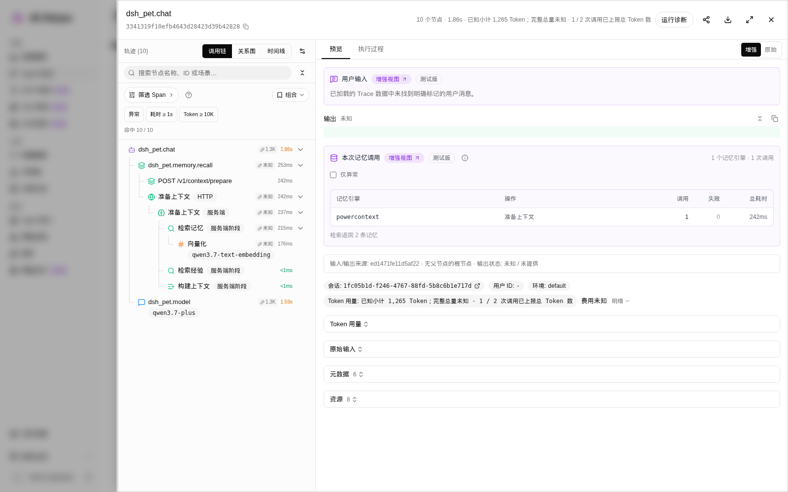

# dsh-pet-powercontext

**一只会陪你聊天、跟着工作状态动起来，也能记住你偏好的桌宠。**

[English](README.md) · 简体中文 · [文档](docs/zh/README.md) · [安装](docs/zh/guides/installation.md) · [下载版本](https://github.com/ob-labs/dsh-pet-powercontext/releases)

把她拖到工作区旁边，写一段人设，随时聊两句。桌宠既能作为 **DeepSeek Harness（DSH）插件**，也能 **独立运行**。可选的 **PowerContext + seekdb** 长期记忆，让事实与偏好在退出近期聊天窗口后仍有机会被找回。

本项目基于 [PC2005-cloud/dsh-pet](https://github.com/PC2005-cloud/dsh-pet)。

本 fork 基于 [ob-labs/dsh-pet-powercontext](https://github.com/ob-labs/dsh-pet-powercontext)，保留原有功能，并为 DeepSeek Harness 桌面版增加可选的小智接入，让屏幕里的桌宠和小智真机共用一份对话。 [小智桌面机器人接入教程](#小智桌面机器人完整教程)

可选功能：[Astra Pro 2.0 MCP 接入](docs/zh/guides/robot.md)支持目录发现、示教程序、区域移动和语音播报，无需客户端 Python/SDK。

可选功能：[AI Vision 可观测性](docs/zh/guides/observability.md)提供可选的链路采集和输入输出预览，以及平台已有记忆视图的查看入口。[Token 对照](docs/zh/guides/token-comparison.md)可以比较三种上下文策略的回答与实测用量。这些功能已包含在 v0.3.0 发布包中。

## 看看用起来的样子

### DSH、桌宠与记忆在同一个工作区



_DSH Agent 会话和桌宠面板同时保留在工作区。PowerContext 已从桌宠对话生成两条记忆：设备预算与离线备用资料的位置。展开列表可以查看事实及其来源入口；仅有「已同步」状态不能证明抽取或召回成功。_

### 并排看回答，也看 Token 开销



_同一个合成场景、真实模型调用：13 个问题复用 6 条已生成的记忆。相对每次携带完整背景，回答输入减少 **80.5%**（61,387 → 11,944 Token）；计入记忆生成与向量化输入后，减少 **12.6%**（61,387 → 53,641）。这是实测输入量，不是费用节省，也不是对 DSH 默认任务 Agent 策略的测量。_

[首批 6 个问题](docs/assets/screenshots/dsh-token-first-batch.zh.png)计入记忆开销后，输入反而**增加了 65.4%**。已知输出也增加了，向量化输出未报告。解读节省比例时，请一起看 [Token 明细](docs/assets/screenshots/dsh-token-details.zh.png)和[对照操作指南](docs/zh/guides/token-comparison.md)。

### 在 AI Vision 中追踪一次桌宠回复



_这是一条单独的普通桌宠聊天轨迹：从记忆召回进入 PowerContext，再调用回答模型，共 10 个节点，检索返回 2 条记忆。该历史截图中未采集提示词和回答正文；AI Vision 展示已知 Token 小计，缺失用量时完整总量保持未知。此图不是对照实验的汇总。_

以上 **1600 × 1000** 原始截图于 **2026-11-15** 在 Linux Chromium 中采集，使用 **DSH 0.2.2-rc.1**、桌宠预览构建 **`2e080f1`**、PowerContext **`1.5.2.dev148+gfa80ab6b2`** 与本机部署的 AI Vision。演示事实为虚构资料，生成与向量化均调用真实服务。中英文 README 共用原始中文界面，未替换界面文字。[采集说明与验证范围](docs/assets/README.md#live-comparison-and-traces--对照与调用链实拍)。

<details>
<summary>展开观看聊天与记忆召回实录 GIF</summary>


_同一界面保留 DSH 工作区、Agent 会话和桌宠聊天面板，实际发送消息，观看桌宠回复和动作。两边的回复都来自真实模型调用；项目名和饮品偏好是虚构的演示输入。_


_后台抽取后，桌宠再次答出项目名 Moonleaf 和“无糖茉莉花茶”。本次演示将近期聊天设为 **0 轮**：实际模型请求携带召回记忆和新问题，没有携带历史问答。展开「Remembered facts」可以查看抽取后的事实。_

以上 GIF 于 **2026-11-11** 在 Linux Chromium 中实录，使用 **DSH 0.2.2-rc.1** 与 **PowerContext + seekdb**，保留当时界面原有的中英文控件。[查看原尺寸聊天截图](docs/assets/screenshots/dsh-chat.en.png) · [召回与记忆列表](docs/assets/screenshots/dsh-facts.en.png) · [图文来源](docs/assets/README.md)。

</details>

## 先养好一只

**当前代码版本为 v0.3.2。** 以下命令适用于该版本发布后；已发布版本及安装包请查看 [GitHub Releases](https://github.com/ob-labs/dsh-pet-powercontext/releases)。

### 已经在用 DSH

安装 DSH 与 **Node.js 24.9+** 后，在终端执行：

```sh
dsh plugin --profile web add dsh-pet-powercontext@0.3.2
```

DSH 桌面版将 `--profile web` 换为 `--profile desktop`。重启 DSH，在「设置 → 桌宠配置」调整桌宠，在右侧栏「桌宠对话」中聊天。若已启用上游 `dsh-pet`，先停用它并保留数据目录。

### 独立运行（Windows、macOS、Linux）

安装 **Node.js 22.12+** 后，在 PowerShell 或终端执行：

```sh
npx --yes dsh-pet-powercontext@0.3.2 --setup
```

在打开的设置页选择聊天模型、填写密钥并检查连接。使用期间保持终端运行；图形桌宠需要桌面环境，首次启动可能下载 Electron。独立运行不需要先安装 DSH。

Windows x64 使用原生安装路径；长期记忆会自动准备 Python 和 seekdb。Windows ARM64 的本机 seekdb 暂不支持。Linux 已完成真实服务验证，Windows x64 和 macOS 的完整安装流程仍待实机验证。桌面安装包请以 [Release 附件](https://github.com/ob-labs/dsh-pet-powercontext/releases)实际提供的文件为准。

v0.3.2 的在线记忆安装默认使用国内源，无需手动设置：uv 和 Python 依赖从清华镜像下载，Python 运行时从 npmmirror 下载。PowerContext 固定为 **1.5.2**，SQLite 与 seekdb 安装及环境复用均校验该版本。兼容的本机 Python 和依赖缓存仍会复用；离线包使用内置环境。首次启用还需要建库和迁移，建议演示前提前完成。

### 配置模型并开启长期记忆

1. **先配置聊天模型。** DSH 桌宠沿用宿主聊天模型；在 DSH 模型设置中使用下表的 MiniMax 地址、模型与订阅 Key。独立模式在自己的设置页填写。
2. **打开本机长期记忆。** DSH 进入「设置 → 桌宠配置 → 本机长期记忆」，选择 MiniMax 中国端与通义千问·北京，填写各自密钥。聊天模型与记忆整理模型的配置分别保存。
3. **点击「检查并启用记忆」。** 程序检查模型连接，自动安装 PowerContext 1.5.2 和 seekdb，并启动服务。优先复用兼容的本机 Python 和依赖缓存，并显示安装进度；缺少运行环境或依赖时下载。云模型调用仍需联网，记忆功能按需开启。
4. **验证记忆。** 告诉桌宠一条独特偏好，等待「记得的事」出现对应事实；清空近期聊天后再追问，检查是否召回。仅显示「已同步」不代表整理已完成。

| 配置项                     | 值                                                  |
| -------------------------- | --------------------------------------------------- |
| 聊天 / 记忆整理服务        | MiniMax 中国端套餐订阅                              |
| 生成接口地址               | `https://api.minimax.cn/v1`                         |
| 生成模型                   | `MiniMax-M3.1-Flash`                                |
| 生成密钥                   | 自己的 `sk-cp-` 订阅 Key；按量 Key 不共用套餐额度   |
| 向量服务                   | 百炼：通义千问·北京                                 |
| Embedding 接口地址         | `https://dashscope.aliyuncs.com/compatible-mode/v1` |
| Embedding 模型             | `text-embedding-v4`                                 |
| Embedding 密钥             | 自己的百炼 API Key                                  |
| 向量维度 / dimensions 参数 | `1024` / 勾选发送                                   |

新配置使用一个本机 seekdb 记忆库；已有 SQLite 配置继续沿用，不自动转换。已有库的向量模型、地址与维度不能直接切换。模型检查、聊天、记忆整理和检索都可能产生用量。

### 按需接入 AI Vision 与 Token 对照

AI Vision 是可选的外部可观测平台。在可观测性设置中填写已有平台地址与认证信息，保存并检查连接；暂停再恢复记忆，使新配置应用到本机记忆服务。插件不会自动部署 AI Vision 平台。启用可观测性时，正文采集默认开启，可在设置中关闭；开启后提示词、回复及相关记忆内容会发送到所配置的平台。

在桌宠对话中打开「Token 对照」，点击「一键填入演示内容」，即可填入虚构的星河书店场景：三条事实、三个问题。内容可以编辑，替换已有草稿前会确认；点击「准备记忆并运行」后才开始调用模型。

对照实验使用同一模型比较完整历史、短历史加 PowerContext、仅短历史三组回答。v0.3.0 将三组回答的输出预算统一提高到 8192 Token，为推理模型返回正文留出空间；用量按实际返回值统计，截断或空回答仍会报告失败。请把记忆整理与向量化开销计入比较。内置小样本用于演示流程，不保证节省 Token。

[安装详情](docs/zh/guides/installation.md) · [记忆指南](docs/zh/guides/memory.md) · [AI Vision](docs/zh/guides/observability.md) · [Token 对照](docs/zh/guides/token-comparison.md)

## 桌宠与记忆分别做什么

| 桌宠提供                             | PowerContext 提供                  |
| ------------------------------------ | ---------------------------------- |
| 点击、拖拽、抛掷，播放 100+ 动画素材 | 跨越近期窗口和重启，按问题召回事实 |
| 独立人设、聊天与可配置语音           | 不同宠物各自的记忆 Scope           |
| 待办、提醒、睡觉和可选碎碎念         | 查看来源、更正事实、申请遗忘       |
| 跟随 DSH 会话工作状态                | 分别限制近期正文与召回正文         |
| 安装自己的角色和动画包               | 暂停记忆后继续使用近期聊天         |

会话联动、语音识别、服务商余额等能力取决于运行方式和宿主服务。聊天中记住一句承诺，不会自动创建提醒或执行动作。

模型预设包括 MiniMax、DeepSeek、OpenAI、通义千问、硅基流动、火山方舟、智谱、Kimi、Ollama 和可选 LiteLLM 网关。聊天、记忆整理与 Embedding 可以使用不同服务商。[功能说明](docs/zh/reference/features.md) · [动画预览](docs/zh/reference/gallery.md)

## 为什么接记忆，token 又省在哪里

小窗口控制当轮输入。PowerContext 将成功的文本问答交给后台整理，再按新问题召回相关证据，让应用不必每次把完整聊天都带给模型，也能接上较早的经历。


所提供的《教你如何多快好省来养大肥鱼》使用合成对话和真实模型调用，几个结果回答的是不同问题：

| 实验                                  | 观察结果                                  | 适用条件                                                         |
| ------------------------------------- | ----------------------------------------- | ---------------------------------------------------------------- |
| 140 回合回放：原生近期 10 轮改为 4 轮 | 聊天输入减少 **35.8%**                    | 小窗口答中旧事实 0/25；加入记忆达到 25/25，也增加了开销          |
| 固定 1000 轮初始历史，复用 100 次     | 已知生成输入减少 **88.9%**                | 对照是每次携带全历史，不是默认原生 10 轮                         |
| 同一复用实验，计入整理与维护          | 已知费用估算 **¥4.73 对 ¥6.99，低 32.3%** | 历史价格估算；回答结果不同，对照还有七次未计价调用，不是实际账单 |

长期记忆不会自动更便宜，短对话和大批历史的初次导入可能更贵。请连同[完整实验、原图与限制](docs/zh/explanation/memory-and-cost.md)一起看，再按[用量控制指南](docs/zh/guides/token-budget.md)调整自己的桌宠。

## 数据与控制权

记忆默认关闭，按需开启。本机记忆首次设置采用近期 4 轮、近期正文 6000 字节和召回正文 4096 字节。字节不是 token，后台抽取、输出、重试和其他功能还有各自的费用。

- **已同步**只表示对话送达 PowerContext，不代表抽取完成或一定能召回。
- **暂停**保留数据；**遗忘**将原子记忆移出召回，来源和历史版本仍保留。删除本机聊天不会删除远端证据。
- 本机记忆在宿主的 `$DSH_HOME/dsh-pet/powercontext/` 下运行，远程模型仍会收到生成和 Embedding 所需文本。
- 只采集桌宠对话，尚未给 DSH 编程 Agent 会话接入记忆，也不会自动导入旧聊天。

[启用、验证与管理记忆](docs/zh/guides/memory.md)

## 小智桌面机器人完整教程

屏幕里的桌宠和小智真机是与大肥鱼交流的两个入口。在桌宠对话打字，回复可以由真机念出来。直接对真机说话，转写和回复也会出现在同一份桌宠对话里。两个入口都能下达已映射的动作。以下步骤以 Apple Silicon Mac 上的 DeepSeek Harness 桌面版、小智 Go v0.6.5 和运行 v2.5.3 固件的 Otto DIY ESP32-S3 为例。小智 Go 在本机运行，负责设备连接和播报。桌宠未单独指定聊天模型时，沿用 Harness 当前选中的模型及其登录凭据或 API Key。

### 安装 fork 的桌面插件

前面的常规安装步骤使用上游发布包。接入小智时，使用 Node.js 24.9+ 和 pnpm 构建并安装本 fork。若已启用上游桌宠插件，先停用它，并完全退出 Harness 桌面版。保留 `$DSH_HOME/dsh-pet/` 可继续使用现有配置和记忆，`DSH_HOME` 默认是 `~/.dsh`。

```sh
git clone https://github.com/beatenevo/dsh-pet-powercontext-xiaozhi.git
cd dsh-pet-powercontext-xiaozhi/dsh-pet
pnpm install --frozen-lockfile --ignore-scripts
mkdir -p ../xiaozhi-plugin-build
npm pack --pack-destination ../xiaozhi-plugin-build
dsh plugin --profile desktop add "$PWD/../xiaozhi-plugin-build/dsh-pet-powercontext-0.3.2.tgz"
```

如果终端找不到 `dsh`，macOS 桌面版可使用 `/Applications/DeepSeek Harness.app/Contents/Resources/runtime/cli/bin/dsh`。重启 Harness 后打开「设置 → 桌宠配置」，在侧栏的「桌宠对话」发一条消息，确认模型能正常回复。

### 启动小智 Go 并绑定真机

1. 下载并解压与主机架构匹配的小智 Go v0.6.5 发布包，保留同目录的配置、模型和动态库。在解压目录启动服务。首次使用时打开 `http://127.0.0.1:8080/setup` 创建管理员，之后在 `http://127.0.0.1:8080/login` 登录。发布包的 README 包含开机启动说明。 [小智 Go v0.6.5 发布包](https://github.com/hackers365/xiaozhi-esp32-server-golang/releases/tag/v0.6.5)

   ```sh
   ./xiaozhi_server -c main_config.yaml -manager-enable=true -manager-config manager.json
   ```

2. 在本机后台创建智能体，例如「桌宠联动」。首次部署可用「配置向导 → OTA 配置」里的 MQTT/UDP 选项一起保存三个服务的配置。也可以在「服务配置 → OTA 配置」手动填写。以 `192.168.1.20` 为 Mac 的局域网 IP 示例，WebSocket 地址填 `ws://192.168.1.20:8989/xiaozhi/v1/`。使用 MQTT/UDP 常驻连接时，启用本机 MQTT 服务，在 OTA 中下发端点 `192.168.1.20:2883`，让 OTA 和 MQTT 服务使用同一签名密钥，并在 UDP 配置中将对外主机设为 `192.168.1.20`、端口设为 `8990`。若后台区分测试和生产配置，给设备实际使用的一项填写地址。
3. 让 Mac 和小智连到同一可互访的 Wi-Fi。在设备配网页填入 OTA 地址 `http://192.168.1.20:8989/xiaozhi/ota/`，保存后重启。设备显示六位绑定码后，到「智能体管理 → 设备列表 → 绑定设备」录入代码，并关联「桌宠联动」。已绑定的设备可在设备列表核对在线状态和归属。 [设备配网与绑定](https://docs.xiaozhi.me/zh/getting-started/wifi-and-binding.html)
4. 确认固件提供所需的 MCP 动作和主动播报。本文的动作与播报实测使用 Otto DIY ESP32-S3 v2.5.3。其他板型按各自固件的工具列表配置。若小智日志出现 `Unknown message type: notify`，请查板型对应的固件说明，确认支持 `notify` 再测试桌宠主动播报。 [Otto 固件下载与烧录说明](https://ottodiy.tech/docs/downloads)

日常联动需要小智 Go 与 Harness 桌面版同时运行。小智可独立供电，通过 Wi-Fi 连接。换 Wi-Fi 或热点时，保留 Go 数据目录和原有绑定。先确认设备和 Mac 能互访，若 Mac 的局域网 IP 变了，就更新 OTA、WebSocket、MQTT 和 UDP 的相关地址。设备连不到 OTA 地址时，再进入配网页修改。

### 在桌宠里连接设备并测试播报

1. 在本机 Go 后台创建 OpenAPI Token，可直接打开 `http://127.0.0.1:8080/user/api-tokens`。在设备列表记下绑定设备的数字 `ID`。
2. 在 Harness 的「设置 → 桌宠配置 → 机器人设置」选择「小智机器人」，填入 **小智设备 OpenAPI 地址** `http://127.0.0.1:8080/api/open/v1` 和数字设备 ID，开启「启用机器人连接」并保存。填入上一步创建的 Token，点击「保存设备令牌」，再点击「检查连接」。设备当前发布的工具会显示在工具列表里。
3. 在 Go 后台「AI 配置 → TTS 配置」创建并测试一个启用的 TTS 配置，例如 Edge TTS 的 `zh-CN-XiaoxiaoNeural`，设为默认。再到桌宠对话的「小智机器人 → 手动控制」输入一句测试文本并点「让机器人播报」，从真机扬声器确认有声。打开「机器人播报桌宠发言」后，新的回复、碎碎念和梦话会交给小智播报。

`xiaozhi.me` 的 `wss://api.xiaozhi.me/mcp/` 接入点用于让官方云上的小智调用外部工具。这里的桌宠通过本机 Go 的 OpenAPI 调用设备和发起播报，令牌由本机 Go 管理。 [小智 MCP 接入说明](https://docs.xiaozhi.me/zh/mcp/quickstart.html)

### 映射跳舞和举放双手

在机器人设置的「高级设置」中添加动作，选择检查连接时发现的工具，再填动作名称和固定 JSON 参数。下面是实测设备的 `self_otto_action` 映射。其他固件请以工具列表中的名称和参数类型为准。

| 动作名   | 固定参数 JSON                                         |
| -------- | ----------------------------------------------------- |
| 跳舞     | `{"action":"radio_calisthenics"}`                     |
| 举起双手 | `{"action":"hands_up","direction":0,"speed":700}`     |
| 放下双手 | `{"action":"hands_down","direction":0,"speed":1000}`  |
| 举起左手 | `{"action":"hands_up","direction":1,"speed":1000}`    |
| 举起右手 | `{"action":"hands_up","direction":-1,"speed":1000}`   |
| 放下左手 | `{"action":"hands_down","direction":1,"speed":1000}`  |
| 放下右手 | `{"action":"hands_down","direction":-1,"speed":1000}` |

保存后开启「允许对话触发机器人动作」。默认需要点击当轮的确认按钮。想让明确指令直接执行时，再开启「直接执行模式（无需逐次确认）」。在桌宠对话输入「举起双手」即可先验证一次。完成下面的语音桥配置后，也可以直接对小智说「给我跳支舞吧」「举起左手」或「放下右手」。真机语音每轮匹配一个动作。遇到「抬手」这类没指定哪只手的说法，可以改说一个完整的映射名称，等这次做完再说下一条。

### 让真机麦克风接入同一份桌宠对话

1. 在桌宠配置中选好「语音识别」服务。先用桌宠聊天框的录音按钮测一段语音，确认能转成文字。识别服务沿用该配置，所需凭据取决于你选择的识别服务。
2. 在 Harness 主机创建本地桥配置。以下命令适用于首次配置，会生成独立的 64 字符十六进制令牌，并将权限设为仅当前用户可读写。已有 `xiaozhi-voice.json` 时直接使用原来的端口和令牌。保存后完全退出并重启 Harness。

   ```sh
   voice_dir="${DSH_HOME:-$HOME/.dsh}/dsh-pet"
   mkdir -p "$voice_dir"
   (
     umask 077
     set -C
     printf '{"port":9096,"token":"%s"}\n' "$(openssl rand -hex 32)" > "$voice_dir/xiaozhi-voice.json"
   )
   ```

3. 在同一台 Mac 的 Go 后台设置以下配置并启用。对只绑定一个智能体的安装，可以设为默认并让「桌宠联动」继承。语音桥只监听回环地址 `127.0.0.1`，机器人仍通过局域网连 Go。

   | 后台页面   | 配置值                                                                                                                              |
   | ---------- | ----------------------------------------------------------------------------------------------------------------------------------- |
   | VAD 配置   | 使用 `ten_vad`                                                                                                                      |
   | ASR 配置   | FunASR，主机 `127.0.0.1`，端口 `9096`，模式 `offline`，采样率 `16000`，块大小 `[5, 10, 5]`，块间隔 `10`，关闭自动结束，超时 `75` 秒 |
   | LLM 配置   | OpenAI，基础 URL `http://127.0.0.1:9096/v1`，模型 `dsh-pet`，API 密钥填桥配置文件中的 `token`                                       |
   | 智能体编辑 | 「桌宠联动」使用上述 LLM 和已测试的 TTS，关闭实时对话模式，使用普通转写对话                                                         |

4. 唤醒小智并对它说一句话，再看 Harness 桌宠对话里是否出现转写和回复。小智 Go 负责播报这轮回复。LLM 配置里的 OpenAI 选项用于连接本地桥，真正生成回复的是 Harness 里选中的聊天模型。桥令牌、设备 OpenAPI Token 和模型服务凭据分别填在各自的配置中。

### 开启声纹并验证昵称播报

1. 完整联动使用本仓库的小智 Go v0.6.5 补丁。补丁会把同一轮的声纹识别结果交给对话，并在 macOS 上为 Edge 普通话合成未返回音频的情况提供系统音色备用。构建步骤见下方。 [小智 Go 补丁](patches/xiaozhi-go/v0.6.5-speaker-audio.patch)
2. 在小智 Go 的 `asr_server.json` 将 `server.host` 设为 `127.0.0.1`，端口设为 `9000`，设置 `speaker.enabled=true` 和 `recognition.enabled=false`，保留安装包自带的声纹模型路径和存储设置。将 `manager.json` 的 `speaker_service.url` 设为 `http://127.0.0.1:9000`，并在后台「服务配置 → 声纹识别配置」填同一地址并启用。用以下命令启动补丁版，再访问 `http://127.0.0.1:9000/health` 检查服务状态。

   ```sh
   ./xiaozhi_server-patched -c main_config.yaml -manager-enable=true -manager-config manager.json \
     -asr-enable=true -asr-config asr_server.json
   ```

3. 在浏览器登录本机后台后直接打开 `http://127.0.0.1:8080/user/speakers`。创建声纹组，关联「桌宠联动」。可以对真机说一段 5–10 秒的清晰语音，再点「管理声纹 → 上传新样本 → 从历史记录选择」，试听并选自己的录音。也可以录制或上传 WAV。历史录音来源需要 Go 的历史记录功能保存用户音频。
4. 「描述」可以填备注，例如「本人声纹」。「Prompt」可以写「当前说话人是小明，昵称是『小明』。对方询问身份时，用这个昵称称呼他。你是大肥鱼，用第一人称回答。」想统一音色时，声纹组的 TTS 配置和音色可以留空，随智能体设置。若已给声纹组指定音色，识别命中后会优先用这个音色。
5. 用另一段录音点击「验证」，再对真机说「听得出我是谁吗？用我的昵称打个招呼」。检查桌宠文字是否包含昵称，并听真机读完。Go 的后台验证阈值与对话实时阈值分别配置，实测环境分别采用 `0.6` 和 `0.4`。保留「声纹聊天限制 → 关闭」时，未命中声纹的语音也能正常对话。

<details>
<summary>构建并安装带声纹和播报补丁的小智 Go</summary>

在终端进入本 fork 的根目录。准备 Go 1.24.11 和 Node.js。参照 v0.6.5 发布流程准备 libopus、`pkg-config`、ONNX Runtime 头文件和匹配的 sherpa-onnx 动态库，并在当前终端设置 `PKG_CONFIG_PATH`、`C_INCLUDE_PATH` 和 `CGO_LDFLAGS`，分别指向 opus 的 pkg-config 目录、ONNX Runtime 头文件目录和 sherpa-onnx 库目录（`-L` 参数）。然后应用补丁并构建。 [Go v0.6.5 macOS 构建环境](https://github.com/hackers365/xiaozhi-esp32-server-golang/blob/v0.6.5/.github/workflows/build-release.yml)

```sh
fork_root="$PWD"
git clone --recurse-submodules --branch v0.6.5 \
  https://github.com/hackers365/xiaozhi-esp32-server-golang.git ../xiaozhi-go-v0.6.5-src
cd ../xiaozhi-go-v0.6.5-src
git apply --check "$fork_root/patches/xiaozhi-go/v0.6.5-speaker-audio.patch"
git apply "$fork_root/patches/xiaozhi-go/v0.6.5-speaker-audio.patch"
(cd manager/frontend && npm ci && npm run build)
mkdir -p manager/backend/static/dist
cp -R manager/frontend/dist/. manager/backend/static/dist/
CGO_ENABLED=1 go build -tags 'nolibopusfile asr_server manager embed_ui' \
  -ldflags '-s -w -extldflags=-Wl,-headerpad_max_install_names' \
  -o xiaozhi_server-patched ./cmd/server
/bin/bash build/macos/fix_rpath.sh ./xiaozhi_server-patched
codesign --force --sign - ./xiaozhi_server-patched
```

将新二进制放进原发布包目录，与原来的 `xiaozhi_server` 并列。退出正在运行的 Go，改用新二进制启动，继续使用原发布包的配置、动态库和 `data/` 目录。若使用 `launchd`，同步更新启动程序路径。启动后先确认后台和声纹服务可访问，再让真机重新建立对话。

</details>

### 常见问题

- **后台显示「暂无 OTA 配置」**。到「服务配置 → OTA 配置」检查设备使用的配置是否已保存。
- **检查连接失败**。先确认 Go 正在运行、设备已绑定且在线，再核对 OpenAPI 地址、数字设备 ID 和在该地址保存的令牌。
- **桌宠有回复，真机没声音**。先测试 Go 的 TTS 并检查设备音量，再核对固件是否支持主动播报 `notify`，以及设备能否访问 Go 发出的局域网音频地址。如果 Go 发出的地址有误，在 `main_config.yaml` 把 `notify.public_url` 设为设备可达的地址，例如 `http://192.168.1.20:8989`。
- **真机在两种音色之间切换**。先检查 Go 里智能体的 TTS，以及声纹组的 TTS 配置和音色。识别命中后，声纹组设置会覆盖智能体。清空声纹组的覆盖项即可继承智能体音色。Edge 普通话合成没有返回音频时，macOS 补丁也可能在当轮改用系统的 Tingting 音色。「湾湾小何」需要在 Go 的豆包 WebSocket TTS 配置中填写有该音色权限的火山引擎应用及访问令牌。 [火山引擎音色列表](https://www.volcengine.com/docs/6561/1257544)
- **小智麦克风能打开，桌宠没有转写**。先用桌宠录音按钮测试识别服务，再核对 `xiaozhi-voice.json`、FunASR 的端口与离线模式。若有转写但没有正常回复，核对 Go LLM 的回环地址和桥令牌。
- **识别到了声纹，回复里没有昵称**。检查声纹组是否关联当前智能体、是否填写 Prompt，以及 Go 是否运行带本仓库补丁的版本。后台没显示「声纹管理」时，登录后可直接打开 `/user/speakers`。
- **动作超时或断线**。先观察真机和动作回执，确认设备状态后再下达下一条指令。取消等待只能结束本机等待，设备需能提供停止工具才能由插件请求停止。

在上述 macOS 和 Otto 组合上，已实测桌宠回复由小智播报、真机语音进入同一份桌宠对话、声纹命中后念出昵称，以及真机直接执行跳舞、举起双手和放下双手。左右手分别举放已通过自动化测试。

## 文档与开发

| 下一步       | English                                                                                  | 简体中文                                                                      |
| ------------ | ---------------------------------------------------------------------------------------- | ----------------------------------------------------------------------------- |
| 跟着教程使用 | [First pet](docs/en/tutorials/first-pet.md)                                              | [养好第一只桌宠](docs/zh/tutorials/first-pet.md)                              |
| 配置与排障   | [Guides](docs/en/README.md#do)                                                           | [操作指南](docs/zh/README.md#解决具体问题)                                    |
| 接入其他应用 | [HTTP](docs/en/reference/http-api.md) · [Cordis](docs/en/reference/cordis.md)            | [HTTP](docs/zh/reference/http-api.md) · [Cordis](docs/zh/reference/cordis.md) |
| 开发与发布   | [Development](docs/en/reference/development.md) · [Releases](docs/en/guides/releases.md) | [开发](docs/zh/reference/development.md) · [发布](docs/zh/guides/releases.md) |

源码位于内层 `dsh-pet/` 包目录：

| 目录                  | 职责                                   |
| --------------------- | -------------------------------------- |
| `src/host/`           | 配置、HTTP 路由、聊天、队列与 DSH 接入 |
| `src/client/`         | 角色渲染、设置和聊天界面               |
| `src/shared/`         | 共享类型、动画与交互规则               |
| `src/standalone/`     | 独立应用、模型设置与本机记忆生命周期   |
| `runtime/`、`assets/` | Electron 外壳与角色素材                |

## 致谢与许可

代码采用 [MIT 许可](LICENSE)。角色形象、动画、提示词与源视频遵循[单独的许可和署名要求](dsh-pet/ASSET-LICENSE.md)，包括上游注明的 CC BY-NC-SA 4.0，不适用代码许可。

鲸鱼娘是社区二创形象，并非 DeepSeek 官方角色。原型“溟月”：[上善无形](https://space.bilibili.com/4456176)；女仆鲸鱼娘设计：[ZipZipPipe](https://space.bilibili.com/4168597)；原版桌宠：[PC2005-cloud/dsh-pet](https://github.com/PC2005-cloud/dsh-pet)；长期记忆：[PowerContext](https://github.com/oceanbase/powercontext)。
